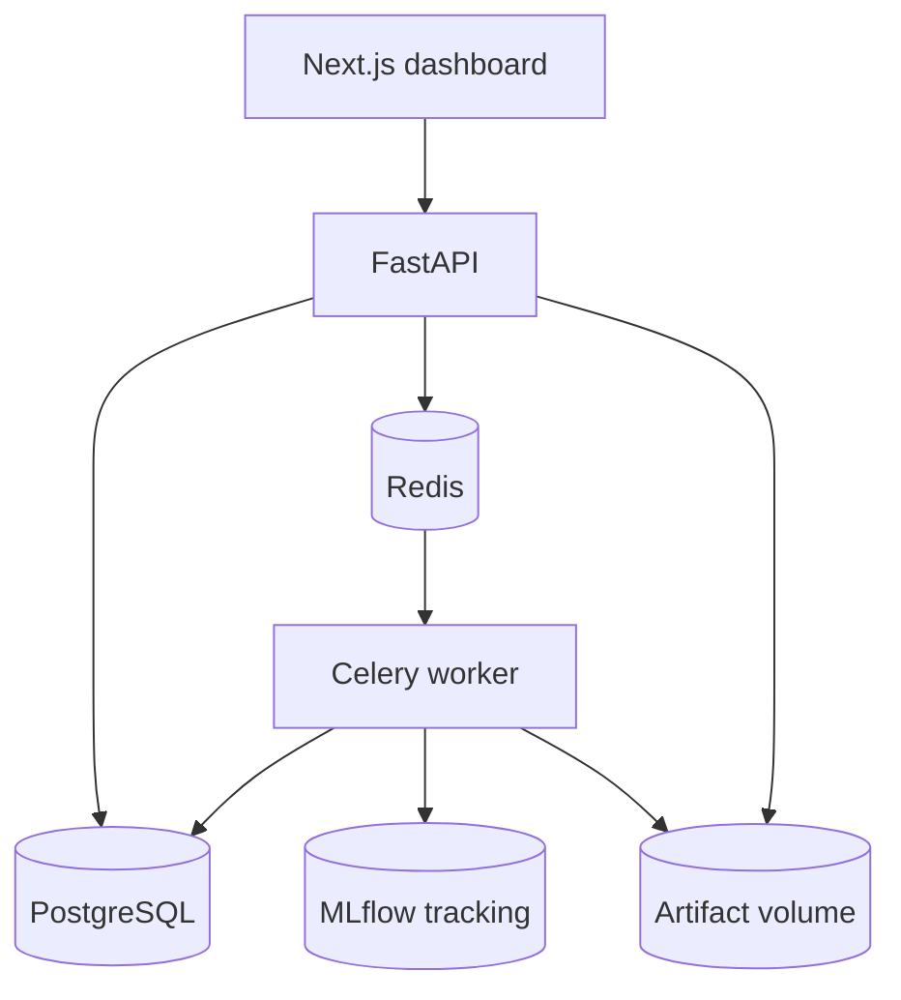

# ModelForge

ModelForge is a self-hosted workspace for structured machine learning. Upload a CSV, inspect and version it, train a reproducible classification or regression pipeline, compare runs, and run predictions against immutable model versions. The default workspace runs locally with CPU models and no API keys.

## Start with Docker Compose

Requires Docker Engine or Docker Desktop with Docker Compose v2.

```bash
cp .env.example .env
docker compose up --build --detach --wait
```

| Service | Local URL |
|---|---|
| Dashboard | http://localhost:3000 |
| FastAPI Swagger UI | http://localhost:8000/docs |
| Readiness | http://localhost:8000/health |

PostgreSQL, Redis, and the Celery worker stay on the Compose network. An Alembic service applies the schema before the API or worker starts. The workspace is intended for a trusted local operator. Keep the default loopback bindings or put an authenticated, authorized reverse proxy in front of both public routes before permitting remote access.

```bash
docker compose logs -f api worker
docker compose down
```

Named volumes persist PostgreSQL metadata, Redis broker state, datasets, the MLflow tracking database, and model artifacts.

## Try the workflow

1. Open **Datasets**. Upload `samples/iris.csv` with the name **Iris**. Inspect missing values, a distribution, the preview, and Pearson correlations.
2. Open **Experiments**. Name the experiment **Iris logistic**, choose the uploaded version, and select `species`, **Classification**, and **Logistic regression**.
3. Proceed to preprocessing. Keep the default seed of 42 and 20% holdout, set Optuna trials to 3, create the experiment, and click **Start training**.
4. Watch the progress panel. The completed run shows held-out scores, cross-validation, its confusion matrix, class-level metrics, and permutation importance. A successful fit registers a model version automatically.
5. Train a second run with the same dataset, target, seed, and holdout. Open **Compare** and rank completed runs by the same metric.
6. Open **Models**. Select **Iris logistic · v1** and upload `samples/iris.csv` for batch predictions and a demonstration of labeled performance. This reuses the benchmark data. Use a new labeled batch when estimating production performance.
7. Change the operation to **Compare drift** and upload `samples/iris_shifted.csv`. The sample adds 4 cm to `sepal_length`, which should be flagged.
8. For regression, upload `samples/regression.csv`, select `price` and **Linear regression**, and inspect the residual plot. For a tunable regression run, use Random forest, Gradient boosting, or XGBoost.

Use the same experiment name for independent runs when you want them registered as successive versions under one model name. Reuse a dataset name to upload another dataset version.

### Reproduce a run from the API

Run from the repository root against a fresh local workspace. The example uses `curl` and `jq`.

```bash
api=http://localhost:8000/api/v1
dataset=$(curl -fsS -F name=Iris -F file=@samples/iris.csv "$api/datasets" | jq -er .id)
run=$(jq -n --arg dataset "$dataset" '{
  name:"Iris logistic", dataset_id:$dataset, target:"species",
  task:"classification", algorithm:"logistic", seed:42, test_size:0.2, cv_folds:3, trials:3
}' | curl -fsS -H 'Content-Type: application/json' -d @- "$api/experiments" | jq -er .id)
curl -fsS -X POST "$api/experiments/$run/train"
curl -fsS "$api/experiments/$run"
# Once status is completed:
curl -fsS "$api/experiments/$run/metrics"
model=$(curl -fsS "$api/models" | jq -er --arg run "$run" '.[] | select(.experiment_id == $run) | .id')
curl -fsS -H 'Content-Type: application/json' "$api/models/$model/predict" \
  -d '{"rows":[{"sepal_length":5.1,"sepal_width":3.5,"petal_length":1.4,"petal_width":0.2}]}'
```

Online requests accept up to 256 rows with exactly the registered feature keys. Supply `null` for a missing value. Batch and drift endpoints accept up to 5,000 CSV rows and use the stored feature schema. A labeled batch returns classification accuracy and macro F1 or regression MAE and RMSE. Dataset uploads are limited to 10 MiB, 25,000 rows, and 100 columns by default.

## Architecture



FastAPI and Celery share one Python package. PostgreSQL stores job state and registry metadata. Redis queues CPU-heavy training. A separate MLflow store records run configuration, selected parameters, and metrics. The artifact volume keeps source CSVs and fitted pipelines. This split keeps training off the HTTP request path and lets the API and worker share validation and persistence logic. The default workspace uses one worker and shared local storage.

| Python module | Responsibility |
|---|---|
| `datasets` | Strict CSV parsing, schema inference, descriptive statistics, quality and correlation |
| `schemas`, `preprocessing` | Typed configuration, task checks, split validation, missing-value imputation, scaling and bounded one-hot encoding |
| `strategies`, `training`, `neural` | Estimator selection, stratified or shuffled cross-validation, seeded Optuna and final fitting |
| `evaluation` | Held-out metrics, confusion matrix, class report, residuals and permutation importance |
| `jobs`, `tracking` | Queuing, progress, cooperative cancellation, failure state, registry publication and MLflow |
| `registry`, `storage` | Versioned metadata, integrity checks, fitted state, inference validation and labeled batch scoring |
| `drift` | Training baselines, numeric KS with Holm adjustment, categorical Jensen–Shannon distance and missingness |
| `database`, `api` | SQLAlchemy persistence, activity, and the OpenAPI contract |

Logistic regression supports classification, ordinary least squares supports regression, and Random forest, Gradient boosting and XGBoost support both. The pipeline is cloned and fitted inside each CV fold. Optuna sees only training-fold scores. The chosen pipeline is refit on the training split, and the held-out split is used once for reported model evaluation and permutation importance. Input column types come from the uploaded CSV; exclude identifiers, time-derived leakage and post-outcome columns in the wizard.

See [Artifact storage](docs/artifacts.md) for format, backups, and migration considerations.

## Development and tests

Python 3.12 and Node 24 are the tested runtime targets. For a lightweight development session, use SQLite and Celery eager mode, which executes training in the request process.

```bash
cd backend
uv sync --locked
uv run alembic upgrade head
MF_EAGER=true uv run uvicorn modelforge.api:app --reload
```

In another terminal:

```bash
cd frontend
npm ci
npm run dev
```

Backend quality checks from `backend/`:

```bash
uv run ruff check modelforge migrations tests ../scripts
uv run ruff format --check modelforge migrations tests ../scripts
uv run mypy modelforge
OPENBLAS_NUM_THREADS=1 OMP_NUM_THREADS=1 uv run pytest
```

Frontend checks from `frontend/`:

```bash
npm ci
npm run typecheck
npm run build
npx playwright install chromium
# Run against a fresh Compose workspace or set MF_WEB_URL to a running workspace.
npm run test:e2e
```

The browser test uses a real API and leaves a sample model in the workspace. A fresh CI database keeps runs isolated. To regenerate the checked-in samples, run `uv run --project backend python scripts/generate_samples.py` from the repository root. Iris is Fisher's Iris dataset as distributed with scikit-learn. The shifted fixture is derived from Iris. The regression dataset is generated from a fixed NumPy seed.

## Operating limits and next steps

- The workspace is single-user, with no built-in authentication or tenant isolation. Remote or shared operation needs access control, TLS, and request throttling.
- Training assumes independent, identically distributed rows. Add group-aware and time-aware splits for grouped or temporal data.
- Cancellation is checked between folds and training stages. A fit already in progress runs to its next checkpoint. If the worker crashes during a fit, cancel the stale run and queue it again. Automatic recovery, a transactional broker outbox, and stale-job reconciliation are future work.
- The latest 100 results are displayed by default. API limits can request up to 200. Cursor pagination and retention controls are useful for longer-running workspaces.
- Inference is synchronous. Large datasets, streaming inference, and model caching would require a separate performance pass.
- Drift reports are batch comparisons. Alerts, scheduled drift runs, and long-term drift history are future work.


### Optional PyTorch experiments

Enable the CPU PyTorch extra on both the API and worker to expose **PyTorch MLP** for classification and regression. The strategy uses a seeded dense network, with Optuna search over width and learning rate. Registry artifacts store numeric weights and avoid Python object deserialization.

```bash
MODELFORGE_ENABLE_TORCH=1 docker compose up --build --detach --wait
# With a native Python environment, from backend/:
uv sync --locked --extra torch
OPENBLAS_NUM_THREADS=1 OMP_NUM_THREADS=1 uv run --extra torch pytest -k torch_mlp
```

Turning off the extra makes existing PyTorch models unavailable until the API runs again with the matching dependency.
